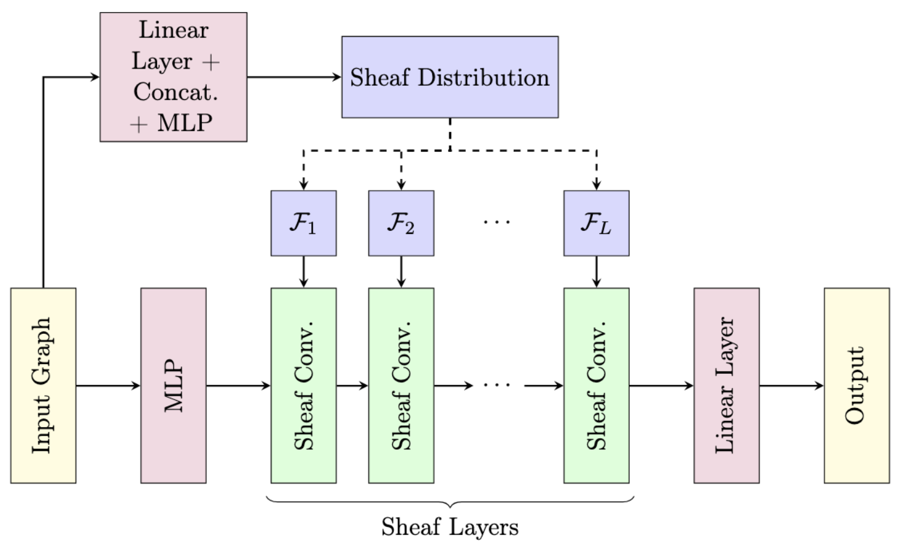

# Bayesian Sheaf Neural Networks

Code for [Bayesian Sheaf Neural Networks](https://arxiv.org/abs/2410.09590).



## Setup

The environment for the corrected UQ workflow is recorded in [environment-review.yml](environment-review.yml):

```bash
conda env create -f environment-review.yml
conda activate bsnn-review
python -m unittest discover -s tests -v
```

This environment uses Python 3.10 and PyTorch 2.5.1 with CUDA 12.1 wheels. The runner also supports CPU execution. The older `environment.yml` remains for historical reference. Exact package versions from the completed runs are recorded in `environment-review-versions.json`.

## Uncertainty Experiments

The UQ workflow compares Bayesian sheaf models with corresponding deterministic NSD models and MC-dropout inference from the same NSD checkpoints. Posterior draws within a fitted model remain separate from independent training seeds.

Run a short end-to-end check from the repository root:

```bash
python exp/uq_analysis/review_study.py --output review_results/smoke --datasets cornell --depths 2 --seeds 0 --epochs 2 --samples 1 3 10 --device cpu --threads 2
```

This trains all six model types and generates diagnostic tables/PDFs. 

The full study uses seven datasets, depths 2/4/6, seeds 0–29, and Bayesian/deterministic variants: 3,780 training trials. Each deterministic checkpoint is evaluated normally and with MC dropout, with stochastic budgets up to 100 draws. Inspect the plan, then run the full workload:

```bash
python exp/uq_analysis/review_study.py --output review_results/full_v2 --plan-only
python exp/uq_analysis/review_study.py --output review_results/full_v2 --device cuda:0
```

Completed checkpoints/metrics are reused on restart. Use a new output directory when changing settings. Distributed workers may use disjoint `--task-index` values with the same `--task-count`; create the shared plan first and pass `--no-report` to workers. Do not run overlapping shards.

Generate a report from completed raw experiment outputs:

```bash
python exp/uq_analysis/review_study.py --output review_results/full_v2 --report-only
```

Checkpoints are selected by validation. ECE uses 15 uniform bins; summary means weight dataset/depth settings equally. Uncertainty is computed within each fitted model before aggregation across seeds. Metric definitions are in the paper.

## Configurations and result summaries

- `config/paper_uq/`: 21 dataset/Bayesian-family base configurations.
- `config/review_v2/`: 42 Bayesian/deterministic base configurations and provenance.
- `splits/paper_48_32_20/`: exact newly generated masks and generation manifest.
- [results/uq_review/](results/uq_review/): scalar metrics, comparisons, diagnostics and run manifests for all 3,780 trials.

The study uses split 0 of the included masks. These UQ partitions and controlled-depth experiments differ from the original paper experiments. The fixed matched settings originate from supplied Bayesian configurations, rather than an independent tuning search for each baseline. 

The 43 numerically truncated deterministic GeneralSheaf trials retain their best finite validation checkpoint and are flagged in `training_status.csv`. Euler used PyTorch 2.5.1; Isaac used 2.3.0, with both environments recorded in the run manifests. Node-level plots require locally generated raw samples.

Check the published scalar summaries without retraining:

```bash
python scripts/summarize_uq_results.py
```

## Gaussian sampling

Diag-BSNN and Gen-BSNN interpret their learned scale parameter as log variance, using `std = torch.exp(0.5 * log_var)` consistently with the Gaussian KL. 

## Hyperparameter sweeps

W&B sweep:

```bash
wandb login
wandb sweep --project bsnn config/bayesbundle_cora_sweep.yml
```

## Acknowledgment

This repository builds on [Neural Sheaf Diffusion](https://github.com/twitter-research/neural-sheaf-diffusion), licensed under Apache 2.0.

Codex helped facilitate the experiments.
